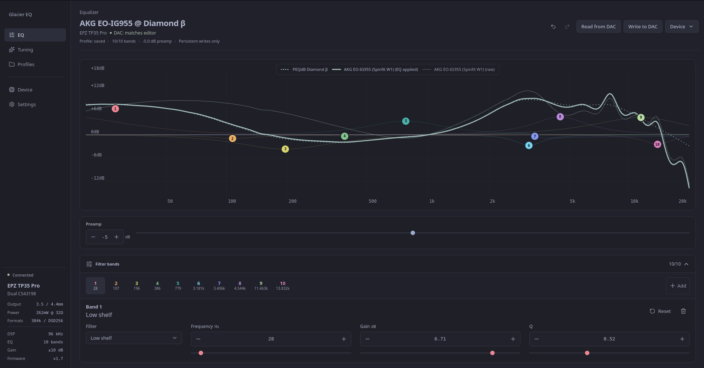

# Glacier EQ

Glacier EQ lets you adjust the parametric EQ on supported USB DAC dongles. Once you've saved your EQ to the DAC, it stays there when you plug it into another device.

[Open the web app](https://bukutsu.github.io/glacier-eq/) (Chrome or Edge) · [Download for desktop or Android](https://github.com/Bukutsu/glacier-eq/releases)

You don't need an account, and it works offline.

## Check your DAC

Search the [device catalog](https://bukutsu.github.io/glacier-eq/#/supported-devices)
by model, family, chip or USB ID. The status filter lets you check which
profiles have been tested. This list comes from the web app's device registry
and is rebuilt with each web build.

EQ support and other controls have separate listings. **Untested** profiles
still need a hardware test. A listed model may not work with every firmware
version or USB mode.

If you try an untested device, [let us know how it goes](https://github.com/Bukutsu/glacier-eq/issues).

## Use it

For a DAC with EQ support:

1. Choose **Connect DAC** and pick your device.
2. **Read from DAC** loads its current EQ. To generate a new EQ from a headphone measurement and target curve, open **Tuning**. AutoEQ uses the filter types and limits your DAC supports.
3. Adjust the filters and choose **Write to DAC** when you're ready to save. On mobile, use **Save to DAC**.

Loading a profile changes the editor. Write it to the DAC to save it, or use
**Use on DAC** on mobile to load and save in one step.

On DACs that support temporary EQ, you can listen without saving. Hold **A/B**
to switch the filters off, then release it to restore them.

Android can also offer to open Glacier EQ when you plug in a supported DAC.
Enable **Open when a DAC is plugged in** under **Settings > General**.

Linux connection issues? See the [setup and troubleshooting guide](https://github.com/Bukutsu/glacier-eq/wiki/Troubleshooting).

## AutoEQ

Pick your headphones and the sound you want in **Tuning**, and Glacier EQ tunes
your DAC for you in an instant. It keeps things loud, so you won't need to turn
your volume up to make up for it.

## Development

For setup, focused tests and platform checks, see [Contributing](CONTRIBUTING.md).

## Support

If Glacier EQ is useful to you, give it a star or support it on [GitHub Sponsors](https://github.com/sponsors/Bukutsu) or [Ko-fi](https://ko-fi.com/bukutsu) :3.

## License

GPL-3.0-only. See [LICENSE](LICENSE).
